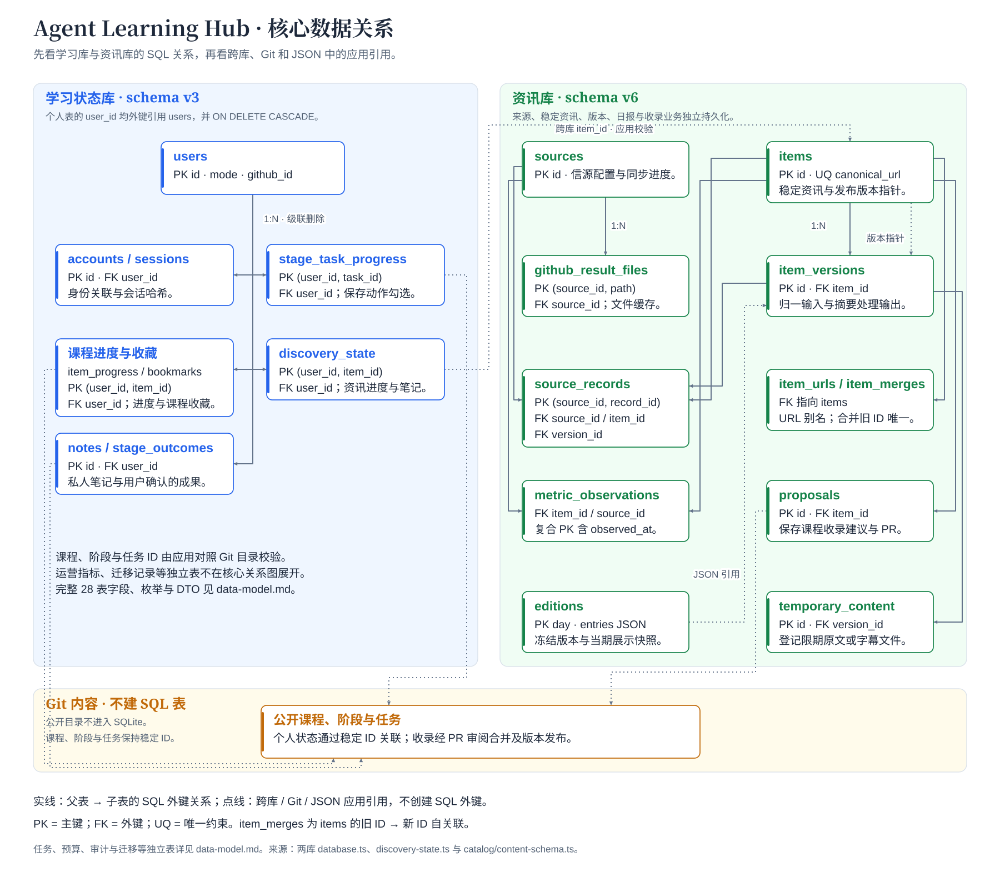

# 核心数据模型

**文档版本：2026.11.15** · 核对日期：2026-11-15。

本项目没有 Java Entity、JPA 或独立 ORM DTO；事实源是 TypeScript 类型、Zod schema 与 SQLite 建表/迁移。以下 SQL 字段来自应用 opener 对全新内存库执行完整迁移后的 PRAGMA，未读取用户数据。学习库 schema v3（11 表），资讯库 schema v6（17 表）。[原始结构证据](../../code/reports/release-2026-11-15/schema.json)。

## 存储边界与关系

公开课程、轨道、阶段、任务与成果模板位于 Git 管理的 `code/content/`；个人状态在学习库；来源、资讯、处理、日报、预算和 PR 在独立资讯库。临时原文在限期卷，表中仅保存文件登记。所有个人表的 user_id 为 SQL 外键并 ON DELETE CASCADE；跨库与 Git ID 只能由应用校验，不能伪装成 SQL 外键。



图中按学习库、资讯库与 Git 内容分区；实线为父表 → 子表的 SQL 关系，点线为跨库、Git 或 JSON 应用引用。分组卡片是阅读摘要，完整字段仍以本文逐表说明为准。

PK=主键（编号为复合主键顺序），FK=数据库外键，UQ=唯一约束。类型为 SQLite 声明类型；TEXT 时间在学习库通常为 UTC ISO 字符串，资讯库 INTEGER 时间通常为 Unix 毫秒。TEXT JSON 在 DTO 解码后才成为对象/数组。NULL 可空；主键的非空语义按应用生成和 SQLite 实际约束理解，不额外声称 DDL 写了 NOT NULL。

## 学习状态库

### `accounts`

把站内用户关联到 OAuth 提供者账户。

| 字段                  | 类型 / 可空 | 键与约束                         | 一句话说明     |
| --------------------- | ----------- | -------------------------------- | -------------- |
| `id`                  | TEXT        | PK1                              | 记录稳定标识   |
| `user_id`             | TEXT        | FK → users.id；级联删            | 所属用户       |
| `provider`            | TEXT        | UQ(provider,provider_account_id) | 身份提供者名称 |
| `provider_account_id` | TEXT        | UQ(provider,provider_account_id) | 提供者账户 ID  |
| `created_at`          | TEXT        | —                                | 创建时间       |

数据库 CHECK 约束（含枚举，原样摘录）：

```sql
provider TEXT NOT NULL CHECK (length(provider) BETWEEN 1 AND 80),
provider_account_id TEXT NOT NULL CHECK (length(provider_account_id) BETWEEN 1 AND 240),
```

### `bookmarks`

保存用户课程收藏。

| 字段         | 类型 / 可空 | 键与约束                   | 一句话说明      |
| ------------ | ----------- | -------------------------- | --------------- |
| `user_id`    | TEXT        | PK1；FK → users.id；级联删 | 所属用户        |
| `item_id`    | TEXT        | PK2                        | 目标条目稳定 ID |
| `created_at` | TEXT        | —                          | 创建时间        |

数据库 CHECK 约束（含枚举，原样摘录）：

```sql
item_id TEXT NOT NULL CHECK (length(item_id) BETWEEN 1 AND 200),
```

### `discovery_state`

单独保存个人资讯进度、收藏和笔记。

| 字段          | 类型 / 可空 | 键与约束                   | 一句话说明                 |
| ------------- | ----------- | -------------------------- | -------------------------- |
| `user_id`     | TEXT        | PK1；FK → users.id；级联删 | 所属用户                   |
| `item_id`     | TEXT        | PK2                        | 目标条目稳定 ID            |
| `target_type` | TEXT        | 默认 'news'                | 固定为 news 的资讯目标类型 |
| `status`      | TEXT        | 默认 'not_started'         | 个人阅读状态               |
| `bookmarked`  | INTEGER     | 默认 0                     | 是否收藏（0/1）            |
| `note`        | TEXT        | 默认 ''                    | 个人资讯笔记               |
| `updated_at`  | TEXT        | —                          | 最后更新时间               |

数据库 CHECK 约束（含枚举，原样摘录）：

```sql
target_type TEXT NOT NULL DEFAULT 'news' CHECK(target_type='news'),
status TEXT NOT NULL DEFAULT 'not_started' CHECK(status IN ('not_started','in_progress','completed')),
bookmarked INTEGER NOT NULL DEFAULT 0 CHECK(bookmarked IN (0,1)),
```

### `item_progress`

记录课程条目的进度与阅读位置。

| 字段         | 类型 / 可空 | 键与约束                   | 一句话说明         |
| ------------ | ----------- | -------------------------- | ------------------ |
| `user_id`    | TEXT        | PK1；FK → users.id；级联删 | 所属用户           |
| `item_id`    | TEXT        | PK2                        | 目标条目稳定 ID    |
| `status`     | TEXT        | —                          | 个人阅读状态       |
| `position`   | INTEGER     | 默认 0                     | 阅读位置，非负整数 |
| `updated_at` | TEXT        | —                          | 最后更新时间       |

数据库 CHECK 约束（含枚举，原样摘录）：

```sql
item_id TEXT NOT NULL CHECK (length(item_id) BETWEEN 1 AND 200),
status TEXT NOT NULL CHECK (status IN ('not_started', 'in_progress', 'completed')),
position INTEGER NOT NULL DEFAULT 0 CHECK (position >= 0),
```

### `notes`

按课程或阶段保存私人笔记。

| 字段         | 类型 / 可空 | 键与约束                                               | 一句话说明                |
| ------------ | ----------- | ------------------------------------------------------ | ------------------------- |
| `id`         | TEXT        | PK1                                                    | 记录稳定标识              |
| `user_id`    | TEXT        | FK → users.id；级联删；UQ(user_id,scope_type,scope_id) | 所属用户                  |
| `scope_type` | TEXT        | UQ(user_id,scope_type,scope_id)                        | 笔记目标类别              |
| `scope_id`   | TEXT        | UQ(user_id,scope_type,scope_id)                        | 笔记目标 ID               |
| `body`       | TEXT        | —                                                      | 笔记正文，最多 20000 字符 |
| `created_at` | TEXT        | —                                                      | 创建时间                  |
| `updated_at` | TEXT        | —                                                      | 最后更新时间              |

数据库 CHECK 约束（含枚举，原样摘录）：

```sql
scope_type TEXT NOT NULL CHECK (scope_type IN ('item', 'stage')),
scope_id TEXT NOT NULL CHECK (length(scope_id) BETWEEN 1 AND 200),
body TEXT NOT NULL CHECK (length(body) <= 20000),
```

### `operational_metrics`

按小时存匿名运营计数。

| 字段                | 类型 / 可空 | 键与约束 | 一句话说明         |
| ------------------- | ----------- | -------- | ------------------ |
| `bucket_started_at` | TEXT        | PK1      | 小时聚合桶开始时间 |
| `event`             | TEXT        | PK2      | 运营事件枚举       |
| `scope`             | TEXT        | PK3      | 固定运营范围枚举   |
| `outcome`           | TEXT        | PK4      | 运营结果枚举       |
| `count`             | INTEGER     | 默认 0   | 累计次数（非负）   |
| `last_occurred_at`  | TEXT        | —        | 最近发生时间       |

### `schema_migrations`

记录学习库已应用迁移。

| 字段         | 类型 / 可空 | 键与约束 | 一句话说明   |
| ------------ | ----------- | -------- | ------------ |
| `version`    | INTEGER     | PK1      | 迁移序号     |
| `applied_at` | TEXT        | —        | 迁移应用时间 |

### `sessions`

保存会话 token 哈希及到期时间。

| 字段         | 类型 / 可空 | 键与约束              | 一句话说明                     |
| ------------ | ----------- | --------------------- | ------------------------------ |
| `id`         | TEXT        | PK1                   | 记录稳定标识                   |
| `user_id`    | TEXT        | FK → users.id；级联删 | 所属用户                       |
| `token_hash` | TEXT        | UQ(token_hash)        | 会话凭据哈希，不保存原始 token |
| `expires_at` | TEXT        | —                     | 到期时间                       |
| `created_at` | TEXT        | —                     | 创建时间                       |

数据库 CHECK 约束（含枚举，原样摘录）：

```sql
token_hash TEXT NOT NULL UNIQUE CHECK (length(token_hash) BETWEEN 1 AND 256),
```

### `stage_outcomes`

记录用户提交及主动确认的阶段成果。

| 字段           | 类型 / 可空 | 键与约束              | 一句话说明       |
| -------------- | ----------- | --------------------- | ---------------- |
| `id`           | TEXT        | PK1                   | 记录稳定标识     |
| `user_id`      | TEXT        | FK → users.id；级联删 | 所属用户         |
| `stage_id`     | TEXT        | —                     | 阶段 ID          |
| `kind`         | TEXT        | —                     | 任务或成果类别   |
| `url`          | TEXT / NULL | —                     | 原始或成果 URL   |
| `summary`      | TEXT / NULL | —                     | 成果文字说明     |
| `confirmed_at` | TEXT / NULL | —                     | 用户主动确认时间 |
| `created_at`   | TEXT        | —                     | 创建时间         |
| `updated_at`   | TEXT        | —                     | 最后更新时间     |

数据库 CHECK 约束（含枚举，原样摘录）：

```sql
stage_id TEXT NOT NULL CHECK (length(stage_id) BETWEEN 1 AND 200),
kind TEXT NOT NULL CHECK (kind IN ('repository', 'demo', 'reflection')),
summary TEXT CHECK (summary IS NULL OR length(summary) <= 20000),
```

### `stage_task_progress`

保存阶段实践动作勾选。

| 字段         | 类型 / 可空 | 键与约束                   | 一句话说明          |
| ------------ | ----------- | -------------------------- | ------------------- |
| `user_id`    | TEXT        | PK1；FK → users.id；级联删 | 所属用户            |
| `task_id`    | TEXT        | PK2                        | 阶段动作 ID         |
| `completed`  | INTEGER     | 默认 0                     | 动作是否完成（0/1） |
| `updated_at` | TEXT        | —                          | 最后更新时间        |

数据库 CHECK 约束（含枚举，原样摘录）：

```sql
task_id TEXT NOT NULL CHECK (length(task_id) BETWEEN 1 AND 200),
completed INTEGER NOT NULL DEFAULT 0 CHECK (completed IN (0, 1)),
```

### `users`

区分本地与云端身份，保存最少展示信息。

| 字段           | 类型 / 可空 | 键与约束      | 一句话说明                     |
| -------------- | ----------- | ------------- | ------------------------------ |
| `id`           | TEXT        | PK1           | 记录稳定标识                   |
| `mode`         | TEXT        | —             | 身份运行模式                   |
| `github_id`    | TEXT / NULL | UQ(github_id) | GitHub 稳定数字 ID（文本存储） |
| `display_name` | TEXT        | —             | 显示名称                       |
| `created_at`   | TEXT        | —             | 创建时间                       |
| `updated_at`   | TEXT        | —             | 最后更新时间                   |

数据库 CHECK 约束（含枚举，原样摘录）：

```sql
mode TEXT NOT NULL CHECK (mode IN ('cloud', 'local')),
display_name TEXT NOT NULL CHECK (length(display_name) BETWEEN 1 AND 160),
```

## 资讯库

### `admin_actions`

记录管理员业务操作的审计证据。

| 字段         | 类型 / 可空 | 键与约束 | 一句话说明                  |
| ------------ | ----------- | -------- | --------------------------- |
| `id`         | TEXT        | PK1      | 记录稳定标识                |
| `actor`      | TEXT        | —        | 管理员标识，无 SQL 用户外键 |
| `action`     | TEXT        | —        | 管理动作名称                |
| `target`     | TEXT        | —        | 被操作业务对象标识          |
| `detail`     | TEXT        | —        | 受控审计详情（JSON）        |
| `created_at` | INTEGER     | —        | 创建时间                    |

### `discovery_migrations`

记录资讯库已应用迁移。

| 字段         | 类型 / 可空 | 键与约束 | 一句话说明   |
| ------------ | ----------- | -------- | ------------ |
| `version`    | INTEGER     | PK1      | 迁移序号     |
| `applied_at` | INTEGER     | —        | 迁移应用时间 |

### `editions`

冻结每日选排与展示快照。

| 字段         | 类型 / 可空 | 键与约束 | 一句话说明                      |
| ------------ | ----------- | -------- | ------------------------------- |
| `day`        | TEXT        | PK1      | 上海时区日报日期，YYYY-MM-DD    |
| `cutoff`     | INTEGER     | —        | 当期候选截止时刻                |
| `entries`    | TEXT        | —        | EditionEntry[] 冻结快照（JSON） |
| `created_at` | INTEGER     | —        | 创建时间                        |

### `github_result_files`

缓存授权 GitHub 结果文件版本、解析记录及拒绝原因。

| 字段             | 类型 / 可空 | 键与约束             | 一句话说明                                |
| ---------------- | ----------- | -------------------- | ----------------------------------------- |
| `source_id`      | TEXT        | PK1；FK → sources.id | 所属来源；item_merges 中表示被合并资讯 ID |
| `path`           | TEXT        | PK2                  | 授权仓库中的结果文件路径                  |
| `sha`            | TEXT        | —                    | 文件 blob SHA                             |
| `commit_sha`     | TEXT        | —                    | 来源提交版本                              |
| `record_ids`     | TEXT        | 默认 '[]'            | 该文件解析得到的来源记录 ID 列表（JSON）  |
| `parser_version` | INTEGER     | 默认 0               | 解析器版本                                |
| `rejected`       | INTEGER     | 默认 0               | 拒绝记录计数                              |
| `error_code`     | TEXT / NULL | —                    | 脱敏错误码                                |

### `item_merges`

保留资讯合并后的旧 ID 转发。

| 字段         | 类型 / 可空 | 键与约束           | 一句话说明                                |
| ------------ | ----------- | ------------------ | ----------------------------------------- |
| `source_id`  | TEXT        | PK1；FK → items.id | 所属来源；item_merges 中表示被合并资讯 ID |
| `target_id`  | TEXT        | FK → items.id      | 合并后保留的资讯 ID                       |
| `created_at` | INTEGER     | —                  | 创建时间                                  |

数据库 CHECK 约束（含枚举，原样摘录）：

```sql
CHECK(source_id<>target_id)
```

### `item_urls`

把历史或替代 URL 关联到稳定资讯身份。

| 字段      | 类型 / 可空 | 键与约束      | 一句话说明      |
| --------- | ----------- | ------------- | --------------- |
| `url`     | TEXT        | PK1           | 原始或成果 URL  |
| `item_id` | TEXT        | FK → items.id | 目标条目稳定 ID |

### `item_versions`

保存正文输入与处理输出版本。

| 字段                 | 类型 / 可空 | 键与约束                                | 一句话说明                      |
| -------------------- | ----------- | --------------------------------------- | ------------------------------- |
| `id`                 | TEXT        | PK1                                     | 记录稳定标识                    |
| `item_id`            | TEXT        | FK → items.id；UQ(item_id,content_hash) | 目标条目稳定 ID                 |
| `content_hash`       | TEXT        | UQ(item_id,content_hash)                | 内容摘要哈希                    |
| `input`              | TEXT        | —                                       | 归一输入 DiscoveryInput（JSON） |
| `processing_state`   | TEXT        | 默认 'pending'                          | 处理状态（应用层状态字符串）    |
| `output`             | TEXT / NULL | —                                       | SummaryOutput（JSON），可空     |
| `processing_version` | TEXT / NULL | —                                       | 处理或提示词版本                |
| `created_at`         | INTEGER     | —                                       | 创建时间                        |

### `items`

维护资讯稳定身份和当前发布版本。

| 字段                | 类型 / 可空    | 键与约束          | 一句话说明                           |
| ------------------- | -------------- | ----------------- | ------------------------------------ |
| `id`                | TEXT           | PK1               | 记录稳定标识                         |
| `canonical_url`     | TEXT           | UQ(canonical_url) | 规范原文地址（唯一）                 |
| `published_version` | TEXT / NULL    | —                 | 当前公开版本 ID，应用层引用          |
| `pending_version`   | TEXT / NULL    | —                 | 待处理版本 ID，应用层引用            |
| `publication_state` | TEXT           | 默认 'draft'      | 公开发布状态                         |
| `protected_fields`  | TEXT           | 默认 '{}'         | 人工更正保护字段（JSON）             |
| `first_seen_at`     | INTEGER        | —                 | 首次发现时间                         |
| `published_at`      | INTEGER / NULL | —                 | 资讯发布或输入原文日期（依所在模型） |
| `updated_at`        | INTEGER        | —                 | 最后更新时间                         |

数据库 CHECK 约束（含枚举，原样摘录）：

```sql
publication_state TEXT NOT NULL DEFAULT 'draft' CHECK(publication_state IN ('draft','published','withdrawn')),
```

### `jobs`

持久化任务调度、租约、重试与阶段结果。

| 字段           | 类型 / 可空    | 键与约束       | 一句话说明                 |
| -------------- | -------------- | -------------- | -------------------------- |
| `id`           | TEXT           | PK1            | 记录稳定标识               |
| `unique_key`   | TEXT           | UQ(unique_key) | 幂等任务键（唯一）         |
| `kind`         | TEXT           | —              | 任务或成果类别             |
| `payload`      | TEXT           | —              | 任务输入（JSON）           |
| `state`        | TEXT           | —              | 业务状态，见枚举说明       |
| `priority`     | INTEGER        | 默认 0         | 领取优先级                 |
| `available_at` | INTEGER        | —              | 任务最早领取时刻           |
| `attempts`     | INTEGER        | 默认 0         | 已尝试次数                 |
| `max_attempts` | INTEGER        | —              | 最大重试次数               |
| `lease_token`  | TEXT / NULL    | —              | 领取者租约 token           |
| `lease_until`  | INTEGER / NULL | —              | 租约到期时刻               |
| `heartbeat_at` | INTEGER / NULL | —              | 最近心跳时刻               |
| `checkpoint`   | TEXT           | 默认 '{}'      | 可恢复检查点（JSON）       |
| `result`       | TEXT / NULL    | —              | 阶段结果或模型结果（JSON） |
| `error_code`   | TEXT / NULL    | —              | 脱敏错误码                 |
| `created_at`   | INTEGER        | —              | 创建时间                   |
| `updated_at`   | INTEGER        | —              | 最后更新时间               |

数据库 CHECK 约束（含枚举，原样摘录）：

```sql
state TEXT NOT NULL CHECK(state IN ('queued','running','waiting','completed','failed','cancelled')),
```

### `metric_observations`

保存各来源的平台指标观测。

| 字段          | 类型 / 可空 | 键与约束             | 一句话说明                                |
| ------------- | ----------- | -------------------- | ----------------------------------------- |
| `item_id`     | TEXT        | PK1；FK → items.id   | 目标条目稳定 ID                           |
| `source_id`   | TEXT        | PK2；FK → sources.id | 所属来源；item_merges 中表示被合并资讯 ID |
| `observed_at` | INTEGER     | PK3                  | 指标观测时刻                              |
| `metrics`     | TEXT        | —                    | 平台指标键值（JSON）                      |

### `model_receipts`

以调用唯一键管理预留、计费与未知结果核对。

| 字段                  | 类型 / 可空    | 键与约束 | 一句话说明                   |
| --------------------- | -------------- | -------- | ---------------------------- |
| `call_key`            | TEXT           | PK1      | 模型调用幂等键               |
| `budget_day`          | TEXT           | —        | 上海时区预算日期             |
| `state`               | TEXT           | —        | 业务状态，见枚举说明         |
| `reserved_micros`     | INTEGER        | —        | 在途预留，人民币百万分之一元 |
| `actual_micros`       | INTEGER / NULL | —        | 核对后的实际费用，同预留单位 |
| `price_version`       | TEXT           | —        | 价格配置版本                 |
| `currency`            | TEXT           | —        | 供应商报价币种               |
| `exchange_rate`       | REAL           | —        | 折算人民币汇率               |
| `provider_request_id` | TEXT / NULL    | —        | 供应商请求或回执 ID          |
| `result`              | TEXT / NULL    | —        | 阶段结果或模型结果（JSON）   |
| `created_at`          | INTEGER        | —        | 创建时间                     |
| `updated_at`          | INTEGER        | —        | 最后更新时间                 |

数据库 CHECK 约束（含枚举，原样摘录）：

```sql
state TEXT NOT NULL CHECK(state IN ('reserved','dispatched','succeeded','released','unknown')),
reserved_micros INTEGER NOT NULL CHECK(reserved_micros >= 0),
actual_micros INTEGER CHECK(actual_micros >= 0),
```

### `proposals`

跟踪资讯进入课程目录的建议及 PR。

| 字段         | 类型 / 可空    | 键与约束      | 一句话说明             |
| ------------ | -------------- | ------------- | ---------------------- |
| `id`         | TEXT           | PK1           | 记录稳定标识           |
| `item_id`    | TEXT           | FK → items.id | 目标条目稳定 ID        |
| `config`     | TEXT           | —             | 结构化业务配置（JSON） |
| `branch`     | TEXT           | UQ(branch)    | 收录专用分支（唯一）   |
| `pr_number`  | INTEGER / NULL | —             | GitHub PR 编号         |
| `pr_url`     | TEXT / NULL    | —             | GitHub PR URL          |
| `state`      | TEXT           | —             | 业务状态，见枚举说明   |
| `updated_at` | INTEGER        | —             | 最后更新时间           |

### `settings`

保存预算与日报等配置值。

| 字段    | 类型 / 可空 | 键与约束 | 一句话说明     |
| ------- | ----------- | -------- | -------------- |
| `key`   | TEXT        | PK1      | 设置键         |
| `value` | TEXT        | —        | 设置值（文本） |

### `source_records`

绑定来源记录身份、资讯及其版本。

| 字段                  | 类型 / 可空    | 键与约束              | 一句话说明                                |
| --------------------- | -------------- | --------------------- | ----------------------------------------- |
| `source_id`           | TEXT           | PK1；FK → sources.id  | 所属来源；item_merges 中表示被合并资讯 ID |
| `record_id`           | TEXT           | PK2                   | 上游记录稳定标识                          |
| `item_id`             | TEXT           | FK → items.id         | 目标条目稳定 ID                           |
| `version_id`          | TEXT           | FK → item_versions.id | 资讯内容版本 ID                           |
| `last_seen_run`       | TEXT           | —                     | 最近见到记录的完整同步批次 ID             |
| `state`               | TEXT           | 默认 'present'        | 业务状态，见枚举说明                      |
| `source_status`       | TEXT / NULL    | —                     | 上游状态文本                              |
| `upstream_updated_at` | INTEGER / NULL | —                     | 上游更新时间                              |

### `sources`

保存信源配置、调度时间与同步进度。

| 字段                  | 类型 / 可空    | 键与约束  | 一句话说明                 |
| --------------------- | -------------- | --------- | -------------------------- |
| `id`                  | TEXT           | PK1       | 记录稳定标识               |
| `config`              | TEXT           | —         | 结构化业务配置（JSON）     |
| `enabled`             | INTEGER        | —         | 来源是否启用（整数布尔）   |
| `next_sync_at`        | INTEGER        | —         | 下次可同步时刻             |
| `last_success_at`     | INTEGER / NULL | —         | 最近完整成功同步时刻       |
| `upstream_updated_at` | INTEGER / NULL | —         | 上游更新时间               |
| `last_error`          | TEXT / NULL    | —         | 最近同步错误码             |
| `progress`            | TEXT           | 默认 '{}' | 分页或历史导入进度（JSON） |

### `temporary_content`

登记限期原文文件，不长期保存全文。

| 字段           | 类型 / 可空 | 键与约束              | 一句话说明               |
| -------------- | ----------- | --------------------- | ------------------------ |
| `id`           | TEXT        | PK1                   | 记录稳定标识             |
| `version_id`   | TEXT        | FK → item_versions.id | 资讯内容版本 ID          |
| `filename`     | TEXT        | UQ(filename)          | 临时文件相对名称（唯一） |
| `fetched_at`   | INTEGER     | —                     | 原文抓取时刻             |
| `expires_at`   | INTEGER     | —                     | 到期时间                 |
| `content_hash` | TEXT        | —                     | 内容摘要哈希             |

### `worker_health`

记录 worker 心跳与当前任务。

| 字段           | 类型 / 可空 | 键与约束 | 一句话说明              |
| -------------- | ----------- | -------- | ----------------------- |
| `id`           | TEXT        | PK1      | 记录稳定标识            |
| `heartbeat_at` | INTEGER     | —        | 最近心跳时刻            |
| `current_job`  | TEXT / NULL | —        | 当前任务 ID，应用层引用 |

## 枚举与应用层状态

- `users.mode`：cloud / local。`item_progress.status` 与 `discovery_state.status`：not_started / in_progress / completed。`discovery_state.target_type`：news。
- `notes.scope_type`：item / stage。`stage_outcomes.kind`：repository / demo / reflection。动作 completed 与资讯 bookmarked 为 0 / 1。
- `items.publication_state`：draft / published / withdrawn（SQL CHECK）。`jobs.state`：queued / running / waiting / completed / failed / cancelled（SQL CHECK）。`model_receipts.state`：reserved / dispatched / succeeded / released / unknown（SQL CHECK）。
- `jobs.kind` 由 worker 分派 collect / process / edition / curation；SQL 未限制枚举。`source_records.state` 使用 present / unverified-missing / confirmed-deleted；SQL 未限制。处理状态、PR 状态也由应用维护，不能把 string 类型画成数据库 ENUM。
- `item_versions.processing_state` 当前流程包括 pending、source-only、ready、model-not-configured、model-output-invalid 等；处理失败分支以 processing.ts 为准。`proposals.state` 包含 suggested / pr-open / closed / merged-unreleased / live，以 curation.ts 为准。
- `model_receipts.currency` 的 CNY / USD 由模型配置 Zod 校验，不是 SQL CHECK；费用字段为人民币 micros，供应商币种与折算汇率另存。

运营指标完整枚举由以下 DDL 固定：

```sql
CREATE TABLE operational_metrics (
  bucket_started_at TEXT NOT NULL,
  event TEXT NOT NULL CHECK (event IN (
    'page_view',
    'request_error',
    'login_failure',
    'health_check',
    'backup',
    'restore',
    'content_audit',
    'materials_update'
  )),
  scope TEXT NOT NULL CHECK (scope IN (
    'home',
    'roadmap',
    'roadmap-stage',
    'courses',
    'course-detail',
    'reader',
    'search',
    'projects',
    'learning',
    'login',
    'content-policy',
    'contribute',
    'admin',
    'learning-state',
    'data-export',
    'github-login',
    'readiness',
    'backup',
    'restore',
    'content-audit',
    'materials-update'
  )),
  outcome TEXT NOT NULL CHECK (outcome IN (
    'observed',
    'success',
    'client-error',
    'server-error',
    'failure'
  )),
  count INTEGER NOT NULL DEFAULT 0 CHECK (count >= 0),
  last_occurred_at TEXT NOT NULL,
  PRIMARY KEY (bucket_started_at, event, scope, outcome)
)
```

## Git 内容模型（不建 SQL 表）

事实源：`code/modules/catalog/content-schema.ts`。ID 为稳定 kebab-case；下列“引用”全部是应用层引用。字段后的 `?` 为可选，`| null` 为可空。

### Track

| 字段      | 类型 / 枚举                                 | 一句话说明 |
| --------- | ------------------------------------------- | ---------- |
| `id`      | learning / aicoding / agentic / application | 轨道主标识 |
| `title`   | string                                      | 中文名称   |
| `summary` | string                                      | 轨道说明   |

### Stage

| 字段                | 类型 / 枚举         | 一句话说明   |
| ------------------- | ------------------- | ------------ |
| `id`                | string              | 阶段主标识   |
| `order`             | number              | 非负展示顺序 |
| `title`             | string              | 阶段名称     |
| `summary`           | string              | 阶段摘要     |
| `learningGoals`     | string[]            | 学习目标     |
| `maintainerGuide`   | string              | 维护者讲解   |
| `trackIds`          | Track.id[]          | 关联轨道     |
| `taskIds`           | StageTask.id[]      | 动作引用     |
| `projectOutcomeIds` | ProjectOutcome.id[] | 成果模板引用 |
| `learningItemIds`   | LearningItem.id[]   | 配套课程     |
| `legacyImport?`     | LegacyImport        | 旧站溯源     |

### StageTask

| 字段                 | 类型 / 枚举  | 一句话说明 |
| -------------------- | ------------ | ---------- |
| `id`                 | string       | 动作主标识 |
| `stageId`            | Stage.id     | 所属阶段   |
| `title`              | string       | 动作名称   |
| `summary`            | string       | 动作说明   |
| `acceptanceCriteria` | string[]     | 验收标准   |
| `legacyImport?`      | LegacyImport | 旧站溯源   |

### ProjectOutcome

| 字段            | 类型 / 枚举                        | 一句话说明     |
| --------------- | ---------------------------------- | -------------- |
| `id`            | string                             | 模板主标识     |
| `stageId`       | Stage.id / null                    | 所属阶段       |
| `title`         | string                             | 成果名称       |
| `summary`       | string                             | 成果要求       |
| `evidenceTypes` | (repository / demo / reflection)[] | 允许的证据种类 |
| `level?`        | number / null                      | 正整数难度     |
| `legacyImport?` | LegacyImport                       | 旧站溯源       |

### LearningItem

| 字段                | 类型 / 枚举                                            | 一句话说明                 |
| ------------------- | ------------------------------------------------------ | -------------------------- |
| `id`                | string                                                 | 课程主标识，双模式一致     |
| `title`             | string                                                 | 标题                       |
| `track`             | Track.id                                               | 主轨道                     |
| `stageIds`          | Stage.id[]                                             | 服务阶段                   |
| `summary`           | string                                                 | 目录摘要                   |
| `learningGoals`     | string[]                                               | 学习目标                   |
| `sourceUrl`         | string / null                                          | 上游 HTTP(S) 地址          |
| `localPath`         | string / null                                          | 声明的本地主文件           |
| `documentRoot?`     | string                                                 | 静态文档路由根，不增加权限 |
| `accessPolicy`      | owned / upstream-only / local-preferred / unavailable  | 访问策略                   |
| `publicationRights` | project-owned / republication-authorized / third-party | 发布归属                   |
| `author`            | string                                                 | 作者                       |
| `license`           | string                                                 | 许可证名称                 |
| `licenseStatus`     | known / unknown                                        | 许可证确认状态             |
| `tags`              | string[]                                               | 目录标签                   |
| `lastReviewedAt`    | YYYY-MM-DD / null                                      | 最近人工复核日期           |
| `references`        | ContentReference[]                                     | 声明的课节或附加素材       |
| `unavailableReason` | string / null                                          | 不可用原因                 |
| `redirect?`         | {itemId:string, chapter?:string}                       | 退场条目到拥有者的转发     |
| `legacyImport?`     | LegacyImport                                           | 旧站溯源                   |

### ContentReference

| 字段        | 类型 / 枚举   | 一句话说明                         |
| ----------- | ------------- | ---------------------------------- |
| `label`     | string        | 章节名称                           |
| `sourceUrl` | string / null | 该章节上游地址                     |
| `localPath` | string / null | 该章节声明路径；两种地址至少有一项 |

### LegacyImport

| 字段     | 类型 / 枚举                                     | 一句话说明   |
| -------- | ----------------------------------------------- | ------------ |
| `source` | learning-site/data.js                           | 固定溯源     |
| `kind`   | stage / course-card / reading-chapter / project | 旧记录类别   |
| `order`  | number                                          | 原有顺序     |
| `raw`    | Record<string,unknown>                          | 原始导入内容 |

### CollectionSource（sources.config）

| 字段              | 类型 / 枚举                         | 一句话说明                        |
| ----------------- | ----------------------------------- | --------------------------------- |
| `id`              | string                              | 来源主标识                        |
| `name`            | string                              | 来源名称                          |
| `kind`            | feishu / rss / json / html / github | 适配器类别                        |
| `contentType`     | article / video / tool / update     | 内容类型                          |
| `url`             | string                              | 入口 HTTP(S) 地址                 |
| `enabled`         | boolean                             | 是否参与采集                      |
| `publicationMode` | manual / auto                       | 发布模式                          |
| `aggregation`     | boolean                             | 是否使用源摘要聚合                |
| `priority`        | number                              | 0～100 优先级                     |
| `intervalMinutes` | number                              | 5～10080 分钟，默认 60            |
| `topics`          | DiscoveryTopic[]                    | 主题，1～7 项                     |
| `mapping`         | Record<string,string>               | 字段映射，飞书存字段 ID           |
| `appToken?`       | string                              | 飞书 Base 标识                    |
| `tableId?`        | string                              | 飞书子表标识                      |
| `viewId?`         | string                              | 飞书视图标识                      |
| `tokenEnv?`       | string                              | 服务端 token 环境变量名，非密钥值 |
| `appIdEnv?`       | string                              | 服务端 app ID 环境变量名          |
| `appSecretEnv?`   | string                              | 服务端 secret 环境变量名          |
| `listPath`        | string                              | JSON 列表路径                     |
| `linkPattern`     | string                              | 链接过滤模式                      |

### SourceRecord（采集 DTO）

| 字段            | 类型 / 枚举                     | 一句话说明       |
| --------------- | ------------------------------- | ---------------- |
| `recordId`      | string                          | 上游稳定记录 ID  |
| `title`         | string                          | 来源标题         |
| `url`           | string                          | 原文地址         |
| `author?`       | string                          | 来源作者         |
| `summary?`      | string                          | 已有摘要         |
| `publishedAt?`  | string                          | 上游发布日期     |
| `updatedAt?`    | number                          | 上游更新时间     |
| `contentType?`  | article / video / tool / update | 类型覆盖         |
| `metrics?`      | Record<string,string / number>  | 平台指标         |
| `sourceStatus?` | string                          | 上游状态         |
| `provenance?`   | {path:string,commit:string}     | 授权结果文件溯源 |
| `topics?`       | DiscoveryTopic[]                | 主题             |

### DiscoveryInput（item_versions.input）

| 字段            | 类型 / 枚举                     | 一句话说明   |
| --------------- | ------------------------------- | ------------ |
| `title`         | string                          | 归一标题     |
| `url`           | string                          | 规范地址     |
| `author`        | string                          | 作者         |
| `sourceSummary` | string                          | 来源原有摘要 |
| `publishedAt`   | string / null                   | 上游日期     |
| `timeVerified`  | boolean                         | 时间是否核实 |
| `contentType`   | article / video / tool / update | 内容类型     |
| `topics`        | string[]                        | 归一主题     |
| `historical`    | boolean                         | 是否历史导入 |

### SummaryOutput（item_versions.output）

| 字段           | 类型 / 枚举                                           | 一句话说明                    |
| -------------- | ----------------------------------------------------- | ----------------------------- |
| `title`        | string                                                | 中文标题，1～300 字符         |
| `summary`      | string                                                | 摘要，1～5000 字符            |
| `reason`       | string                                                | 推荐依据，1～2000 字符        |
| `topics`       | DiscoveryTopic[]                                      | 主题，最多 7 项               |
| `scores`       | {actionability,verifiability,relevance,impact:number} | 四维评分，各 0～5             |
| `scoreReasons` | {actionability,verifiability,relevance,impact:string} | 各维评分依据，各最多 500 字符 |

### EditionEntry（editions.entries 数组项）

| 字段        | 类型 / 枚举                                         | 一句话说明                                             |
| ----------- | --------------------------------------------------- | ------------------------------------------------------ |
| `id`        | items.id                                            | 资讯应用引用                                           |
| `versionId` | item_versions.id                                    | 冻结摘要版本引用                                       |
| `snapshot?` | {title,summary,reason,topics,score,processingState} | 新期保存冻结前人工更正后的展示快照；旧格式不回填当前值 |

### CurationInput（proposals.config）

| 字段            | 类型 / 枚举        | 一句话说明               |
| --------------- | ------------------ | ------------------------ |
| `itemId`        | news-[a-f0-9]{32}  | 已发布资讯 ID            |
| `learningId`    | string             | 拟收录课程稳定 ID        |
| `stageIds`      | stage-0～stage-8[] | 阶段，1～9 项            |
| `track`         | Track.id           | 学习轨道                 |
| `reason`        | string             | 收录理由，1～2000 字符   |
| `prerequisites` | string             | 前置知识，最多 2000 字符 |

### ExportedLearningState（导出 DTO v2）

| 字段                | 类型 / 枚举               | 一句话说明                       |
| ------------------- | ------------------------- | -------------------------------- |
| `schemaVersion`     | 2                         | 导出协议版本，不是 SQLite 迁移号 |
| `exportedAt`        | string                    | 导出 UTC 时间                    |
| `user`              | {id,mode,displayName}     | 最少用户展示信息，不含凭据       |
| `itemProgress`      | ItemProgressRecord[]      | 课程进度                         |
| `stageTaskProgress` | StageTaskProgressRecord[] | 实践动作                         |
| `bookmarks`         | BookmarkRecord[]          | 课程收藏                         |
| `stageOutcomes`     | StageOutcomeRecord[]      | 用户成果                         |
| `notes`             | NoteRecord[]              | 课程与阶段笔记                   |
| `discoveryState`    | DiscoveryPersonalState[]  | 资讯状态，旧数据导出为空数组兼容 |

主题枚举：Harness Engineering、AI Native 应用、AI 编程、Agent 架构、上下文与记忆、工具与 Skills、评测与生产实践。

## 公开读取 DTO 与类型映射

`PublicItem` 只暴露可公开字段，不返回原始来源配置、凭据或用户记录：

| 字段                                    | 类型                                                | 一句话说明                             |
| --------------------------------------- | --------------------------------------------------- | -------------------------------------- |
| id / versionId                          | string                                              | 稳定资讯 ID 与读取版本 ID              |
| url / title / author / summary / reason | string                                              | 原文入口及公开展示内容                 |
| topics                                  | string[]                                            | 公开主题                               |
| publishedAt                             | string / null                                       | 原文日期，未知时不伪造                 |
| timeVerified                            | boolean                                             | 日期是否核实                           |
| contentType / processingState           | string                                              | 内容类别与摘要处理状态，展示时映射中文 |
| withdrawn                               | boolean                                             | 是否已撤下                             |
| mergedInto                              | string / null                                       | 合并后的目标资讯 ID                    |
| relatedOriginals                        | {title:string,url:string}[]                         | 关联原文                               |
| score                                   | number                                              | 工程价值加权分                         |
| sources                                 | {id:string,name:string}[]                           | 多来源公开身份                         |
| metrics                                 | {observedAt:number,sourceId:string,values:Record}[] | 平台指标及观测时间                     |

学习库 Record DTO 通常将 SQL 的 snake_case 映射为 camelCase（如 user_id → userId），completed / bookmarked 转 boolean；`DiscoveryPersonalState` 为 itemId、targetType、status、bookmarked、note、updatedAt。阶段完成摘要是由动作及用户成果派生的读取模型，没有独立 stage_status 表。会话哈希不包含在导出 DTO。

## 关键关系与一致性

- User 1:N Account / Session / 各类个人状态；删号级联只作用于学习库，不删除公共资讯。课程及阶段 ID 指向 Git 内容，经 catalog gate 校验。
- Source 1:N SourceRecord，Item 1:N ItemVersion；SourceRecord 同时绑定来源、稳定资讯与内容版本，多来源可指向同一资讯。MetricObservation 关联来源与资讯。
- Item 1:N ItemURL；ItemMerge 保留旧 ID → 新 ID，URL 修订不应破坏个人资讯引用。Item 的 published_version / pending_version 没有 SQL 外键。
- Edition.entries 内的 ID、版本与快照是 JSON 应用引用；Proposal.config 对课程/阶段的引用也不是 SQL 外键。PR 合并、固定版本上线与建议创建是独立状态。
- Jobs.payload、WorkerHealth.current_job、ModelReceipt.call_key 通过应用幂等协议关联，没有凭空新增 Job→回执 SQL FK。
- 两库没有 SQL 跨库外键；恢复使用共同批次在线备份，并核对个人资讯目标、任务租约与付费回执。运行库、WAL、SHM 不得手工拆开搬运。

## 来源与更新方式

- 学习迁移：`code/modules/learning-state/database.ts`、`discovery-state.ts`；记录类型：`repository.ts`、导出 `data-export.ts`。
- 资讯迁移：`code/modules/discovery/database.ts`；DTO：`schema.ts`、`repository.ts`、`curation.ts`、`jobs.ts`、`budget.ts`。
- Git 内容：`code/modules/catalog/content-schema.ts`。此文是说明而非第二份迁移事实源；schema 变更后重新执行 opener 与 PRAGMA，再同步字段和 ER 图。
