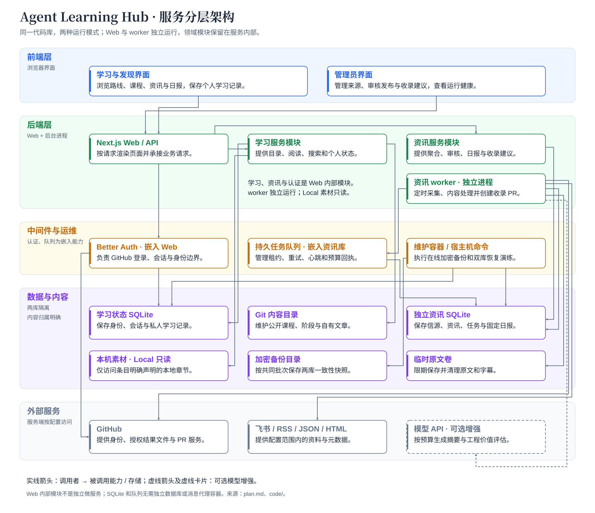
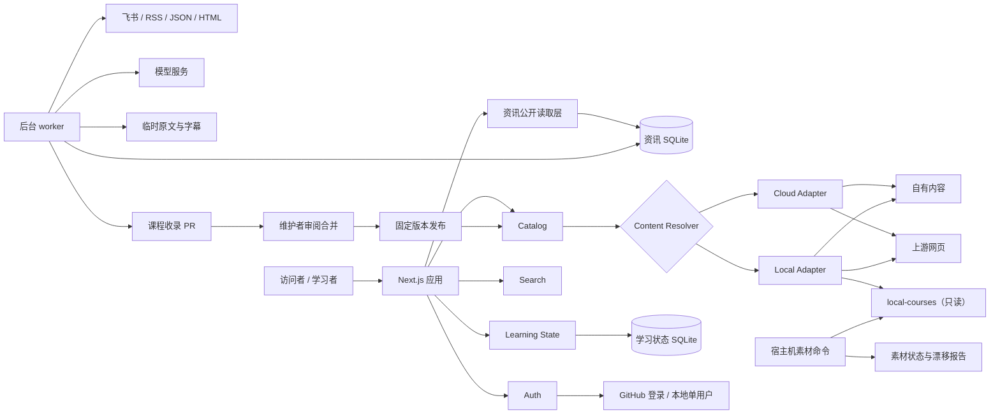

# Agent Learning Hub 产品与技术方案

**版本**：1.2（2026-11-15 现役工程与双库复核；文档发布 2026.11.15）
**配套**：[产品规格](./spec.md) · [任务与完成度](./tasks.md) · [架构决策](../adr/) · [部署与运维](../deploy/README.md)

本文描述架构、内容模型、归属和运行边界。需求 ID 与验收场景以 [spec.md](./spec.md) 为准，完成状态以 [tasks.md](./tasks.md) 为准，工作规则以 [AGENTS.md](../../AGENTS.md) 为准。

2026-11-15 云端资讯扩展已通过 Q16 整体确认。本文同时描述既有学习系统与新增资讯目标架构，资讯模块、worker 与独立资讯库已实现并在本机容器运行，真实接入状态由 tasks.md Phase 9 管理。

## 1. 方案摘要

Agent Learning Hub 提供每日资讯发现与系统学习双入口，工程实践优先的资讯连接九阶段路线、课程导览、自有文章和项目阶梯。学习者保存进度、收藏、私人笔记和阶段成果，阶段以自己提交的成果收尾。

同一套应用有两种运行模式：

- **云端模式**提供公开资讯摘要、学习内容和 GitHub 登录，后台读取配置信源的公开原文或字幕生成摘要，读者通过原站链接访问全文与视频。
- **本地模式**：只读挂载 `local-courses/`，优先站内阅读，本地缺失时回退上游。回环地址上的固定单用户，免登录。

课程与策展内容由 Git 管理，身份和个人状态由学习状态 SQLite 管理，自动采集资讯及发布业务由独立资讯 SQLite 管理。第三方资料记录作者、原始出处与许可证状态，提取原文和字幕放入有期限的临时存储。边界见 ADR 0009～0011。

## 2. 运行基线

**规模数字不写进本文。** 目录条目、章节、素材仓库和索引数量随内容与素材库变化，一律以命令生成的报告为准：

| 事实                 | 来源                                                                  |
| -------------------- | --------------------------------------------------------------------- |
| 目录规模与审计结果   | `npm run audit:content` → `code/reports/content-audit/`               |
| 素材新鲜度           | `npm run materials -- check` → `code/reports/materials/`              |
| 目录漂移             | `npm run audit:materials` → `code/reports/materials/catalog-drift.md` |
| 旧站迁移基线（历史） | `npm run audit:baseline` → `code/reports/baseline/`                   |

端口约定（以 `code/scripts/docker-deploy.sh` 与 `mode-switch.sh` 为准）：

| 场景                            | 地址                                               |
| ------------------------------- | -------------------------------------------------- |
| 开发服务、本机 Docker Local     | `127.0.0.1:3001`                                   |
| 当前 Mac 既有三容器试运行 Local | `127.0.0.1:3003`（`docker-compose.mac-trial.yml`） |
| 本机 Docker Cloud               | `127.0.0.1:3002`                                   |
| 发布 / 生产实例（反代之后）     | `127.0.0.1:3000`                                   |
| 端到端测试的一次性实例（示例）  | `127.0.0.1:3100`                                   |

## 3. 产品定位

- **目标用户**：公开访问者浏览路线与导览；任意 GitHub 用户登录保存学习状态；维护者拥有管理员身份；本地模式是只在本机使用的单用户学习工作台。
- **核心价值**：把 Agent 工程知识组织成可执行的九阶段路线；让每个阶段产出代码、演示或总结；云端便捷访问上游，本地深读大规模素材库。
- **不做**：见 [spec §5.2](./spec.md#52-明确不做)。

## 4. 信息架构

### 4.1 九阶段主线与四条轨道

云端首页提供今日发现与系统学习入口，九阶段路线组织系统学习；Learning、AICoding、Agentic、Application 四条轨道用于课程分类和筛选（IA-001、IA-002）。每个阶段含学习目标、维护者讲解、精选资料、3 个实践任务、验收产物和完成状态。任务可逐项勾选，阶段完成以成果记录及用户确认判定（STATE-005）。

### 4.2 页面

| 类别   | 页面                                                                                 |
| ------ | ------------------------------------------------------------------------------------ |
| 公开   | 首页、九阶段路线与阶段页、课程目录与导览、阅读器、搜索、项目阶梯、内容政策、贡献指南 |
| 需登录 | 我的学习：继续阅读、阶段任务、收藏、私人笔记、阶段成果、导出、删除账户               |
| 管理员 | `/admin`：内容审计、素材状态、数据库、加密备份、匿名运营指标、部署摘要               |

Phase 9 增加发现、资讯详情、主题、历史日报与资讯搜索，学习面板接入资讯状态。管理员后台增加信源、采集任务、审核更正、日报、收录建议与 PR、预算及 worker 健康。页面与完整交互见 [已确认设计](./cloud-content-design.md#1-用户路径与页面)。

管理员判定要求云端模式且 GitHub ID 在 `ADMIN_GITHUB_IDS` 中，因此 `/admin` 在本地模式返回 404；本地运维改用 `/api/health` 和 `code/reports/` 下的审计产物。管理员不得浏览他人笔记正文。

### 4.3 展示层约定

以下约定对应 spec 的 PAGE 系列需求，具体实现规则见 AGENTS.md 第 4、5 节：

- **分页**（PAGE-009）：目录和搜索每页 24 条（`app/components/pagination.tsx`），只对当前页调用 Content Resolver，分页写入 URL。
- **中文标签**（PAGE-011）：schema 枚举经标签函数映射后渲染；导入遗留的 `Unknown` 与内部标签在展示层收敛，数据层保留原样以便人工复核。
- **参数校验**（PAGE-013）：筛选参数先对照目录真实值，不匹配视为未传，不回显。
- **状态快照**（PAGE-017~019）：`StageProgressProvider`（`app/components/stage-progress.tsx`）每页只取一次 `/api/state`；进度徽标最多显示"动作已做完 · 待交成果"，有成果记录才显示"已交成果"。
- **运行时渲染**：所有页面按请求渲染（`force-dynamic`），模式徽标和导航末项读取运行时 `DEPLOYMENT_MODE`。

## 5. 总体架构

前端与后端属于同一个 Next.js Web 服务，学习、认证与资讯是内部模块；worker 为独立进程。Better Auth、SQLite 驱动与持久队列为嵌入能力，不是独立部署的中间件服务。当前不依赖 Redis、MySQL、PostgreSQL、Kafka 或 Java 服务。下图保留内容流转视角；[内部依赖图](./module-deps.svg) 和 [外部依赖图](./external-deps.svg) 补充静态依赖视角。

依赖图来自 TypeScript AST 的 import、export 与字面量动态 import，范围为 `app/`、`lib/`、`modules/`、`scripts/` 的现役源码，排除测试和外部库；类型引用保留为虚线。按目录聚合后可见 `reader ↔ content-resolver` 及含 `lib/auth/runtime/admin/discovery/search` 的环，不能直接认定为文件运行时循环。文件级运行时环为 `learning-state/discovery-state.ts ↔ repository.ts`；加入类型边后还涉及 `database.ts`，另有 `discovery/adapters.ts ↔ github-results.ts` 的混合环。依赖图用行 → 列的完整矩阵保留全部跨模块关系，并以文件详图区分实际循环；“实 / 型”、虚线框及红色叹号同时表达引用类型与环。完整边表和分析范围见 [扫描证据](../../code/reports/release-2026-11-15/dependencies.json)。本轮记录现状，不为画图改动代码结构。

关键 seam 是 Content Resolver：云端与本地各有一个 adapter，调用方不感知文件挂载、上游链接、回退和安全校验。领域逻辑位于 `code/modules/`，页面和路由只调用模块接口；模块职责表见 [README](../../README.md#架构)。

## 6. 核心模块

### 6.1 Catalog

- 读取、校验和查询 `code/content/` 下的轨道、阶段、阶段任务、项目成果、学习条目和自有文章；不读取 SQLite 或 `local-courses/`。
- 可执行契约是 `code/modules/catalog/content-schema.ts`（Zod）：先逐文件校验，再校验跨记录引用；发布归属、访问策略和本地路径的组合约束由 schema 强制（spec §7.2）。
- 接口：`listItems(query)` 按阶段、轨道、标签和访问策略筛选并按稳定 ID 排序；`getItem(id)` / `getStage(id)` 找不到时返回 `undefined`。
- **单一归属**（ADR 0008）：一份本地正文只属于一个未退场条目；退场条目携带 `redirect`，被目录、搜索、计数和学习面板排除，`/courses/<id>` 与 `/read/<id>` 把旧 ID 转发到拥有者。重复归属、无效或自指的 redirect、阶段引用退场条目，都在加载时失败。
- **人手维护**（ADR 0006）：`courses.json` 与 `stages.json` 是权威事实源。旧站转换器 `convert:legacy` 已废弃，仅作溯源保留。目录漂移的自动应用仅处理多路径印证的搬迁，同时更新退场章节转发，并在写入前重新校验完整目录；其余缺失需策展判断。

### 6.2 Content Resolver

`resolve(item, { chapter? })` 返回 `internal-mdx` / `local-document` / `external-link` / `unavailable` 之一并附动作文案（spec §8.1）。

- Cloud Adapter：自有内容站内阅读；第三方资料有上游地址则打开上游，否则不可用；从不读取本地路径。
- Local Adapter：白名单主文件存在时站内阅读；默认入口主文件缺失时按 `listLocalChapters()` 顺序选择首个可读章节。明确指定章节时，只接受条目声明的主路径或引用，缺失时仅回退该章节自己的上游，不借用课程或其他章节的地址。Cloud 也遵循逐章来源选择，但从不访问本地文件。路径必须落在只读挂载根内，拒绝穿越与符号链接逃逸。

### 6.3 Learning State

管理条目状态（未开始 / 进行中 / 已完成）、阅读位置、阶段任务、收藏、私人笔记、阶段成果、导出与删号。打开或点击只标记"进行中"；完成必须由用户确认，阅读位置不等于完成。写接口统一做 CSRF 校验并按用户限流。

### 6.4 Auth

- 云端：Better Auth + GitHub OAuth，只申请 `read:user`，稳定用户 ID 为 `github-<id>`；不保存 provider token，会话 token 只存哈希（ADR 0004）。
- 管理员：按 GitHub 稳定 ID 白名单识别。
- 本地：固定单用户，只接受回环绑定；配置为非回环地址时拒绝免登录启动。
- 课程收录 PR 采用目标仓库专用 GitHub App 服务身份，权限与令牌按仓库操作配置，服务端持有凭据。飞书 API 身份依据三份 Base 的实际权限验证，浏览器访问证据与服务端授权分别验收。

### 6.5 Reader

- **渲染策略**（`modules/reader/markdown.ts`）：第三方素材为 GitHub 而写，普遍混用排版 HTML，因此采用"标签/属性白名单放行"而非全量转义。`script`、`style`、`iframe`、表单等整棵丢弃；未知标签丢标记留文本；`on*` 属性一律丢弃；`href` 只接受 `http(s)`、`mailto`、站内路径和锚点；未闭合标签补齐；有效字符实体原样输出。
- **路径解析**：链接和图片先经 `resolveDocumentRelativePath()` 按当前文档目录解析，再对照条目声明的路径。命中章节的链接改写为 `/read/<id>?chapter=<path>`，否则降级为纯文本；命中声明的图片走 `/api/local-image`，否则整张丢弃。两处白名单必须一起改。
- **图片属性**：所有 `` 带 `loading="lazy"`、`decoding="async"`、`referrerpolicy="no-referrer"`。彻底禁止远程图片属于内容政策变更，需单独 ADR。
- **章节**：允许阅读的章节由条目声明；`listLocalChapters()` 同时决定章节列表和上下章顺序。不对工具仓库、文档站类素材做全量章节声明，以免噪音污染阅读器与索引。
- **退化**：无法安全渲染的文本提供纯源码视图和上游链接；二进制或过大文件不转成 HTML。
- 扩大任何白名单都属于安全边界变更，需先更新 ADR 与规格。

### 6.6 Search

- 云端索引策展内容与已发布资讯的标题、摘要及可公开元数据，本地额外索引声明章节。资讯公开读取层统一控制列表、详情、搜索与日报的发布状态。私人笔记仅按个人权限访问，禁止进入公开索引。
- **一个目标一条结果**（SEARCH-008）：`buildRuntimeSearchIndex()` 把单章条目的正文并入条目本身，多章条目另外产出逐章结果；退场条目整体跳过。数据层的单一归属保证同一正文不会被两次索引。
- 结果定位信息取 `SearchDocument.summary`：条目用摘要，阶段用阶段摘要，章节用所属条目标题。

### 6.7 素材维护

网站进程只读素材状态，从不修改嵌套仓库。宿主机命令（`code/scripts/materials.ts`）：

| 命令                          | 作用                                                                           |
| ----------------------------- | ------------------------------------------------------------------------------ |
| `materials check`             | 比较本地与上游：最新、落后、分叉、本地修改、检查失败；不修改工作区             |
| `materials update <id> --yes` | 单课程、clean working tree、只 fast-forward；成功后审计并重建索引              |
| `materials audit` / `reindex` | 路径审计；重建不含正文的索引快照                                               |
| `materials drift`             | 目录漂移对账：失效路径与候选、未收录仓库、缺少上游回退；`--apply` 只落印证搬迁 |

新鲜度（本地 vs 上游）与漂移（目录 vs 磁盘）是两件事（ADR 0007）。漂移按设计非零退出，不进入 `npm run check`；审计中 `local-path-missing` 是 warning，路径逃逸和非文件仍是 error。

### 6.8 云端资讯模块与后台任务

扩展在 `code/modules/discovery/` 内实现，App Router 页面与接口复用领域模块，后台入口位于 `code/scripts/discovery-worker.ts`。

| 模块职责   | 输入与输出                                                                                              |
| ---------- | ------------------------------------------------------------------------------------------------------- |
| 信源与同步 | 管理来源和字段映射，调用飞书、RSS/Atom、JSON、HTML 与授权 GitHub 结果文件适配器，按分页进度落库输入记录 |
| 身份与版本 | 原文和平台身份去重，多来源关联、正文版本、指标观测、来源缺失与修订保护                                  |
| 内容处理   | 公开原文/字幕提取、归一、摘要与工程价值评估、依据与模型版本、限期清理                                   |
| 发布与日报 | 自动/人工发布、公开字段、统一撤下与恢复、固定日报、截止前候选预览与人工选排、修订                       |
| 学习收录   | 建议、目录校验、分支与 PR 幂等创建、合并与真实上线状态                                                  |
| 任务与预算 | SQLite 持久化队列、租约、回执、预算预留核销、重试、积压与健康                                           |

来源记录、处理版本与发布状态独立维护。采集分页读取配置范围并完整对账，通过来源记录与内容版本去重实现增量处理，确认删除按管理员决定下架，缺失证据不足时标记待核对。平台指标变更刷新观测数据，正文变更才触发相应处理版本。跨原文事件合并由维护者确认。

飞书接入将字段发现与记录预览分开：管理员 `source-fields` 操作只读取字段元数据，经过与其他管理操作相同的身份、CSRF、限流及出站校验，并记录审计。界面按名称选择字段，保存稳定字段 ID；字段选项与 Base、子表绑定，切换目标后重新读取。标题和原文链接为必选映射，JSON 编辑器保留用于指标等扩展映射。

单 worker 调度持久化任务，网络和模型调用在短事务之外执行。任务唯一键、租约、心跳与阶段结果处理重入和崩溃恢复。模型请求按内容及处理版本复用回执，预留额度在数据库事务中完成，结果不明确的调用先核对。输出上限固定为 2048 token，预算预留与请求一致；`DISCOVERY_MODEL_TOKEN_LIMIT_FIELD` 默认 `max_tokens`，仅在供应商要求时配置 `max_completion_tokens`，非法值使模型保持待配置。

预算按 Asia/Shanghai 每日计量，初始 ¥5，耗尽进入等待预算队列，后台可以调整。日报默认 09:00、最多 10 条；来源 schema 默认每 60 分钟；当前聚合预设每 5 分钟，实际以信源配置为准。字段、时间、来源、页面和异常流程详见 [已确认设计](./cloud-content-design.md#功能方案)，契约见 spec DISC-001～027。

生产维护入口 `cloud-maintenance.sh` 从 Compose 应用容器识别实际状态卷、资讯卷与固定版本镜像，在独立维护容器中执行该镜像的双库工具。批次记录两库逐表行数，保留按完整批次执行，健康检查要求两份密文与 manifest 同时有效，完整恢复后才记录批次验证时间。Lighthouse 配置上传包含资讯服务配置及单独的 GitHub App 私钥文件，私钥以只读挂载供网页与 worker 使用。

本地整课策展遵循 ADR 0008：以原作者目录为阅读顺序补齐课程的 `references`，对应单章条目保留 stable ID 并转发到拥有者课节。没有上游教学顺序的集合资料不自动拼课，也不在运行时扫描素材目录。长课程使用可展开目录，默认显示当前位置；章节列表与上下节均来自 `listLocalChapters()`，首尾不越界。旧条目状态仍按原 ID 保留，不自动合并完成状态或删除私人记录。 静态站点课程可显式声明 `documentRoot` 作为文档路由根；无扩展名、目录形式和根相对链接先解析为该根下的路径，再严格匹配课程已声明且可读的 Markdown。该根不授予任何额外文件访问权限，不能自动扫描或透传浏览器根路径。

### 6.9 个人状态与 PR 发布衔接

资讯采用独立稳定目标 ID，学习状态接口、数据迁移、导出与删号共同扩展目标类型。资讯接口单独校验已发布或已撤下目标的存在性，课程接口继续使用 `catalog-gate.ts`，旧课程调用和数据保留兼容路径。导出 v2 在既有字段上增加显式资讯目标记录，Markdown 导出包含资讯笔记。课程收录之后，资讯与课程保持显式关联，个人状态按各目标语义解析。

后台按主题预填阶段与前置知识，使用内容评估理由形成收录建议；维护者可修改并确认。历史内容可按关键词搜索并每页 24 条审核。后台生成含资料、阶段和理由的目录 PR，基于当前目录校验重复目标、稳定 ID 与阶段引用。维护者审阅合并后，通过固定版本发布上线；后台以部署版本的目录证据判断上线，重复创建复用已存在的分支和 PR。

收录生成器以构建时导入的 `code/.prettierrc.json` 与固定版本 Prettier 格式化 JSON；Prettier 属于 worker 运行依赖，在 Next.js 服务端作为外部包加载，避免开发环境有包而生产镜像缺包。目录校验与格式校验均在创建远程树之前完成。

日报在已有发布、时间与处理状态条件之后，统一应用 DISC-011 的工程价值准入，再排序、限量与人工选排。加权分和准入使用同一评分函数；人工选排不能加入未合格 ID，已冻结日报继续使用原来的条目与摘要版本。新期在既有 `editions.entries` JSON 中保存当期标题、摘要、推荐理由、主题、评分和摘要状态的展示快照，包含冻结前人工更正；详情和卡片按同一快照读取，之后更正或模型重算不追改。旧两字段条目按原摘要版本读取，不回填当前人工字段；同一摘要版本不跨期重复收录。该扩展不改变 SQLite 表结构及两库归属。`engineering-summary-v2` 明确中文标题、基于证据的评分及无关内容空主题规则；既有摘要保持兼容，不主动触发全库付费重算。

## 7. 内容维护与归属

### 7.1 课程、资讯与个人状态的归属

- 课程目录、阶段、项目任务和公开文章位于 `code/content/`，通过 Git 提交、审查和发布。
- 学习状态 SQLite 保存身份、会话、个人记录及已有匿名运营指标。资讯 SQLite 保存信源、记录及版本、公开摘要、主题、指标、日报、收录建议、任务、调用回执与管理操作记录。
- 原文与字幕使用独立临时卷。成功生成摘要后保留 7 天，未处理或失败副本自抓取起最多保留 7 天，到期清理并按需重新获取。

交付边界由 [docs/content-boundaries.json](../content-boundaries.json) 定义，`npm run audit:boundaries` 在 CI 中校验：

| 区域                                     | 归属                                                     |
| ---------------------------------------- | -------------------------------------------------------- |
| `code/`（含 `code/content/`）            | 应用源码与可公开的策展内容，进入运行镜像                 |
| `docs/`、`learning-site/`                | 文档与迁移基线，不进镜像                                 |
| `local-courses/`                         | 第三方素材；只允许跟踪其 `README.md`，仅本地模式只读挂载 |
| `code/.data/`、`backups/`、`.env*`、密钥 | 运行状态或秘密，不进 Git、构建上下文或镜像               |
| `code/reports/`                          | 可再生成的审计证据，不进镜像                             |

### 7.2 第三方内容与贡献

- 云端课程页与资讯详情提供摘要、出处和上游链接，后台提取按 ADR 0010 的公开来源与限期存储边界执行，读者在原站访问全文和视频。
- 只有许可证明确且确需站内发布的内容，才可标记为可发布。
- 内容推荐与修正通过 GitHub Issue / Pull Request，经维护者审核后进入 Git；站内不提供投稿表单。
- 自动资讯产生学习收录建议，经管理员生成 PR、维护者审阅合并与版本发布进入课程目录。原始课程与自动资讯分别使用各自的事实源。

## 8. 数据模型

完整字段、主外键和 DTO 见 [核心数据模型](../data/data-model.md) 与 [ER 图](../data/data-model-er.svg)。本次新建内存库执行迁移后，学习库 schema v3、资讯库 schema v6。公开课程不进 SQLite。个人数据表见 [spec §10.2](./spec.md#102-数据表边界)，约束如下：

- 所有个人记录按用户隔离；笔记与成果总结上限 20,000 字符，写请求限流。
- 删除账户级联删除全部个人数据。
- `operational_metrics` 只存固定枚举的事件、范围、结果、计数和最后发生时间，按小时聚合，30 天后清理（ADR 0005）。
- 资讯输入以来源记录 ID 与内容版本追踪，公开资讯以稳定 ID 关联。个人数据与资讯之间由应用层维护引用，下架保留目标身份和状态。
- 学习状态与资讯两库分别执行迁移并记录 schema 版本，回退兼容性通过恢复演练验证。业务处理和管理员审计记录属于资讯库，匿名运营指标按 ADR 0005 管理。

## 9. 双运行模式

|                   | 云端模式                  | 本地模式                           |
| ----------------- | ------------------------- | ---------------------------------- |
| `DEPLOYMENT_MODE` | `cloud`                   | `local`                            |
| 身份              | GitHub 登录               | 固定单用户，免登录                 |
| 绑定              | 反向代理 + HTTPS          | 只绑定 `127.0.0.1`                 |
| 素材库            | 不挂载                    | 只读挂载 `local-courses/`          |
| 阅读              | 自有内容站内，第三方上游  | 优先本地，缺失回退上游；可离线阅读 |
| SQLite            | 服务器持久化卷            | 本机数据目录或 Docker 命名卷       |
| 资讯扩展          | 网页、worker 与独立资讯库 | 本轮使用既有本地学习能力           |

两种模式使用同一镜像、同一课程 ID、同一内容 schema 和同一学习状态模型。

**开发服务的回环约束**：本地免登录身份由 `assertLocalAuthBinding` 强制，非回环绑定直接拒绝启动。`next dev` 会按 `allowedDevOrigins` 拒绝未列入来源的静态资源，页面因此无法完成客户端加载（"我的学习"停在加载态）。`code/next.config.ts` 必须列入 `127.0.0.1`、`localhost`、`[::1]`（NFR-009）。生产的 `next start` 不做这项校验，所以这类问题只能靠界面走查发现。

## 10. 技术选择

- Next.js 16 App Router、React 19、TypeScript；自研白名单 Markdown 渲染器。
- Better Auth + GitHub OAuth；SQLite（better-sqlite3），WAL 仅在 SQLite ≥ 3.51.3 时启用。
- Zod 内容 schema；Vitest 与 Node test runner；Playwright 驱动的走查脚本（开发依赖，不进入生产运行依赖）。
- Docker 多阶段构建；Compose 基础文件加 cloud / local / release / production 覆盖。
- GitHub Actions：双模式质量门禁、按模式的端到端测试、cloud clean-room 镜像扫描；`v*.*.*` tag 触发带 SBOM 与签名溯源的发布。

## 11. 视觉与移动端

- 沿用旧站确认的交通线路图骨架与暖色出版物风格：轨道色、阶段站点、课程网格、衬线阅读器。
- 页头显示运行模式徽标；窄屏（860px 以下）主导航让位给可横向滚动的导航条，右边缘淡出提示还有内容；首页九阶段路线条同样横向滚动。
- 窄屏阅读器把本页目录置于正文之前，正文占满宽度。
- 手机端支持完整的学习、搜索、阅读、笔记和成果流程；素材更新与部署管理只面向命令行。

## 12. 质量与验证策略

测试分层和命名约定见 [docs/testing-strategy.md](../testing-strategy.md)。各层证据相互独立，不能用一层的通过替代另一层：

| 层级           | 命令                               | 覆盖                                                         | 是否在 `check` 中 |
| -------------- | ---------------------------------- | ------------------------------------------------------------ | ----------------- |
| 代码级门禁     | `check:cloud`、`check:local`       | 格式、lint、类型、内容审计、单元与工具测试、生产构建         | 是                |
| 端到端（HTTP） | `test:e2e:cloud`、`test:e2e:local` | 云端真实登录、鉴权、CSRF、状态、导出、删号；本地状态生命周期 | 否（CI 按模式跑） |
| 界面走查       | `audit:ui`                         | 三档视口截图；HTTP 错误、横向溢出、页面高度、控制台报错      | 否                |
| 功能回归       | `audit:functional`                 | 真实点击：链接、翻页、筛选、章节、学习状态往返               | 否                |
| 素材与边界     | `materials …`、`audit:boundaries`  | 新鲜度、漂移、路径审计、交付边界                             | 否（边界在 CI）   |
| 恢复演练       | `drill:restore`                    | 备份→全新目录恢复→逐表比对，含三组反向对照                   | 否                |
| 外部环境       | 部署 Runbook                       | 真实 OAuth、DNS/TLS、镜像拉取与回滚、异地备份                | 否                |

端到端测试以删号收尾，只能指向带独立 `STATE_DATABASE_PATH` 的一次性实例。

## 13. 运行、隐私、备份与监控

### 13.1 用户数据

只保存 GitHub 身份所需的最少字段，用户 GitHub OAuth 仅用于身份识别，仓库服务身份处理目录 PR。用户可导出课程及资讯的个人状态、彻底删除账户。禁止接入广告型或跨站追踪。飞书同步只使用字段映射所需内容，公开字段经发布层选择，秘密由服务端受控配置引用。

### 13.2 SQLite 备份与恢复

- **迁移**：`modules/learning-state/database.ts` 以事务逐版本应用 schema，失败回滚、下次启动重试；每个连接启用外键，个人表从 `users` 级联删除。
- **状态单元**：数据库、`-wal`、`-shm` 是一个整体，不得在运行中只复制主文件。只读打开时 `-wal` 非空而 `-shm` 缺失会直接 `SQLITE_CANTOPEN`。
- **备份**：`npm run db:backup` 经 SQLite 在线备份 API 取一致性快照，AES-256-GCM 加密并写入 SHA-256 manifest，保留 7 个每日与 3 个每周槽位。调度、异地复制和告警由部署方负责。
- **恢复**：`npm run db:restore -- --input <备份> --target <新路径> --yes` 只写入空目标，解密后先 `quick_check` 再原子安装。
- **演练**：`npm run drill:restore` 备份 → 全新目录恢复 → `integrity_check`、schema 与逐表行数比对 → 用应用的 opener 重开；并证明错误口令、篡改密文、覆盖已有目标都会被拒绝（OPS-007）。开发机用合成数据，云主机经 `lighthouse-deploy.sh restore-drill` 对生产卷只读执行，两边同一段代码。
- 管理员健康摘要只显示备份数量、时间、大小和健康状态，不返回文件名、路径或校验和。

Phase 9 将备份与演练扩展到两个数据库，以共同批次、schema 与应用版本追踪。跨库快照采用短暂应用写入屏障或等价一致性协议，取快照后释放；恢复执行引用、任务租约、回执和目录状态核对，三组反向对照覆盖两库。临时原文卷按到期策略管理，持久化备份保存摘要与处理证据。该扩展由 `db:backup:all` 与 `db:restore:all` 提供，云端两份 Runbook 已登记共同批次与恢复目录约定。

### 13.3 监控

匿名运营遥测使用固定枚举聚合（页面访问、健康检查、状态/API 错误、GitHub 登录失败，以及备份、恢复、内容审计和素材更新的结果），并输出相同字段的结构化日志。管理员健康页显示聚合计数和告警状态，日志收集、异地留存和告警通知由部署方接入，敏感字段按 SEC-005 管理。

上述约束用于匿名运营遥测。资讯模块按配置访问飞书、公开来源、模型和 GitHub 服务，并在资讯库记录受控业务诊断和管理员操作。网页与 worker 健康、上游更新时间、同步时间、积压、预算和备份分别可见，外部服务失败有脱敏原因与重试状态。

### 13.4 部署、容器与数据库运维

- `code/docker/Dockerfile` 是云端与本地共用的多阶段镜像；构建上下文是仓库根目录，由 `.dockerignore` 排除素材、SQLite、备份、秘密和报告。
- 统一入口 `code/scripts/docker-deploy.sh <local|cloud|release> <action>`；`local-preview.sh` 与 `mode-switch.sh` 是它的本机委托。本地模式只允许回环绑定、只读挂载素材、SQLite 用命名卷，`down` 保留卷。
- 云端从根目录 `.env` 读取 Better Auth 与 GitHub OAuth 配置，先 `cloud config` 静态校验；GitHub 应用只注册 `${BETTER_AUTH_URL}/api/auth/callback/github`。
- 发布模式强制 `APP_IMAGE` 为固定版本或 digest，先拉取再启动，从不在生产主机构建源码。正式镜像由 `v*.*.*` tag 触发 `release.yml` 构建；`image-release.sh` 是手工路径，默认交叉构建 `linux/amd64`。`docker-compose.production.yml` 只由生产 Runbook 追加，提供稳定命名卷和只读备份目录。
- `/api/health` 检查内容目录与 SQLite `quick_check`，不返回路径、秘密或用户状态。
- **升级与回滚**：升级前先加密备份；启动后等健康接口，再验证公开浏览、OAuth 跳转、上游链接和管理员边界。镜像故障只切回前一个不可变镜像；数据库不兼容时停止写入，把升级前快照恢复到干净卷后再启动旧镜像。
- TLS、DNS、反向代理、密钥管理、异地备份、告警和正式恢复演练属于部署方责任。可执行步骤与脚本运行位置分类见 [docs/deploy/](../deploy/README.md)。

## 14. 相关决策与文档

ADR 0013 延续双 SQLite 与单 worker。指定飞书 Base 的九个子表是主要信源，openspace 采集结果为补充。聚合来源通过映射和链接校验后发布源标题与摘要，模型增强独立执行。相同链接保留多来源身份并以飞书字段优先，URL 修订维护稳定条目与个人引用。worker 每 5 分钟拉取，持久化分页进度并幂等更新。GitHub 通过服务端授权读取明确的采集结果文件并保存路径和提交版本。客户端保留筛选分页并周期刷新，显示最近同步时间及来源错误。实现及证据见 tasks T9.10，需求见 DISC-028～031。

| ADR                                                                      | 决定                                       |
| ------------------------------------------------------------------------ | ------------------------------------------ |
| [0001](../adr/0001-one-codebase-two-runtime-modes.md)                    | 同一代码库支持云端与本地两种模式           |
| [0002](../adr/0002-third-party-materials-are-references.md)              | 第三方素材只作为来源引用，不进云端内容包   |
| [0003](../adr/0003-self-hosted-nextjs-and-sqlite.md)                     | 自托管 Next.js 与单节点 SQLite             |
| [0004](../adr/0004-cloud-oauth-boundary.md)                              | Better Auth 负责云端 GitHub 身份边界       |
| [0005](../adr/0005-privacy-first-operational-metrics.md)                 | 运营指标只保存匿名聚合                     |
| [0006](../adr/0006-catalog-is-hand-maintained.md)                        | 目录人手维护，旧站转换器废弃               |
| [0007](../adr/0007-catalog-drift-is-proposed-not-applied.md)             | 目录漂移由工具提候选、由人确认             |
| [0008](../adr/0008-chapter-content-has-a-single-owner.md)                | 同一份章节正文只有一个拥有者，退场条目转发 |
| [0009](../adr/0009-source-publication-and-curated-learning-intake.md)    | 信源发布与维护者确认的课程收录 PR          |
| [0010](../adr/0010-public-source-extraction-for-summaries.md)            | 公开原文与字幕的后台摘要处理及限期存储     |
| [0011](../adr/0011-single-host-with-separate-discovery-store.md)         | 单机网页与 worker、独立资讯 SQLite         |
| [0013](../adr/0013-feishu-led-aggregation-with-persistent-read-model.md) | 飞书主导的持久聚合读取                     |

各文档的职责分工见 [AGENTS.md 第 8 节](../../AGENTS.md#8-文档纪律)。分阶段实施计划、上线门槛和下一步工作统一记录在 [tasks.md](./tasks.md)。
